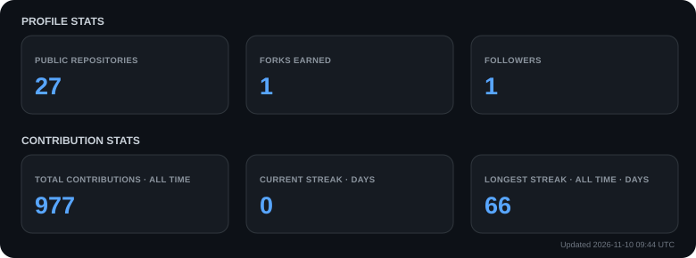

  

  <h3>Electrical Engineering @ IIT Jodhpur</h3>

  

  

    
    
    
  

---

## 👨‍💻 About Me

Hi! I'm **Parth Khiriya**, an Electrical Engineering undergraduate at **Indian Institute of Technology (IIT) Jodhpur**, with a strong interest in building intelligent, scalable, and technically challenging systems.

- 🎓 B.Tech in Electrical Engineering | IIT Jodhpur | CGPA: **8.28**
- 🤖 Interested in **Agentic AI, Machine Learning, and Intelligent Systems**.
- 💻 Experienced in building full-stack applications and distributed backend systems.
- 🧠 Exploring the intersection of AI research, software engineering, and real-world applications.
- 🚀 I enjoy taking projects beyond basic implementations by focusing on architecture, problem-solving, and engineering depth.

**Currently exploring:** Agentic AI, autonomous systems, multimodal learning, and advanced backend architecture.

---

## 🚀 Featured Projects

<table>
  <tr>
    <th>Project</th>
    <th>Tech Stack</th>
    <th>Overview</th>
  </tr>

  <tr>
    <td>
      <a href="https://github.com/ParthKhiriya/NeuroClaw"><b>🧠 NeuroClaw</b></a>
    </td>
    <td>Python, Agentic AI, LLMs</td>
    <td>
      An autonomous AI agent system focused on intelligent task execution, tool interaction, and adaptive workflows.
    </td>
  </tr>

  <tr>
    <td>
      <a href="https://github.com/ParthKhiriya/haptics"><b>🖐️ Haptics</b></a>
    </td>
    <td>Python, PyTorch, EnCodec, Signal Processing</td>
    <td>
      Research-oriented audio-to-tactile synthesis system that learns to generate vibrotactile signals from surface-contact audio using acoustic-guided neural architectures and physics-informed signal processing.
    </td>
  </tr>

  <tr>
    <td>
      <a href="https://github.com/ParthKhiriya/BiteShip"><b>🍔 BiteShip</b></a>
    </td>
    <td>TypeScript, Node.js, Express, MongoDB, RabbitMQ, Socket.IO</td>
    <td>
      Distributed food delivery platform built with microservices, asynchronous event-driven communication, geospatial rider discovery, and real-time order tracking.
    </td>
  </tr>

  <tr>
    <td>
      <a href="https://github.com/ParthKhiriya/demodulator-meta-learning"><b>📡 Meta-Learning Demodulator</b></a>
    </td>
    <td>Python, PyTorch, MAML, ResNet</td>
    <td>
      Model-Agnostic Meta-Learning framework for few-pilot wireless demodulation, featuring a physics-informed 4D ResNet that reduces SER from 13.8% to 10.5% at P=16 in the evaluated scenario.
    </td>
  </tr>
</table>

---

## 🛠️ Technical Skills

### Programming Languages

  
  
  
  
  

### AI / Machine Learning

  
  
  
  
  
  

### Full-Stack Development

  
  
  
  
  
  
  

### Databases, Infrastructure & Tools

  
  
  
  
  
  
  
  

---

## 📚 Certifications & Coursework

- 🎓 **Machine Learning Specialization** — DeepLearning.AI / Coursera
- 🎓 **Full Stack Web Development Certification** — Udemy

**Relevant Coursework:**
Pattern Recognition and Machine Learning, Data Structures and Algorithms, Computer Architecture, Probability and Statistics.

---

## 📊 GitHub Stats

  

> Automatically updated daily using GitHub Actions.

---

## 🤝 Let's Connect

  

  

  

    

  

    

  **Thanks for visiting! Let's build something interesting. 🚀**

